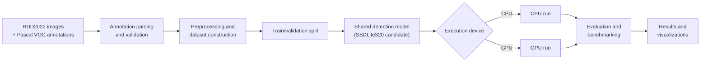

# RoadVision-PDC

**CPU–GPU Accelerated Road Damage Detection Using Deep Learning**

RoadVision-PDC investigates the computational performance of a deep-learning-based
road damage detection pipeline across CPU and GPU execution environments. The project
combines object detection on road-surface imagery with a controlled performance study:
the same model, data pipeline, and training configuration are executed on different
devices so that timing, throughput, and memory behaviour can be compared honestly.

This repository is both an academic Parallel & Distributed Computing study and a
public Computer Vision / Deep Learning engineering portfolio project. It prioritizes
reproducibility, measurement integrity, and clear ownership over headline numbers.

---

## Research question

> How do CPU and GPU execution environments affect the computational performance and
> training efficiency of a deep-learning-based road damage detection system under
> controlled experimental conditions?

---

## Project overview

Road surface degradation — cracks, potholes, alligator cracking — is a routine input to
road maintenance planning and to intelligent transportation systems. Object detection
models can both **classify** the type of damage and **localize** it with bounding boxes
in a single image, which makes detection a natural fit for automated inspection
workflows.

Training those models is itself a parallel-computing problem: the same forward and
backward passes run on very different hardware, and the differences in wall-clock time,
memory behaviour, and throughput are exactly what this project measures. The goal is a
**reproducible experimental study** of that comparison — not a production deployment
demo and not a claim of state-of-the-art accuracy.

Current status: the engineering foundation (dataset tooling, shared training engine,
benchmark harness, test suite) is implemented and tested. Dataset acquisition and
full dataset-backed experiments are **blocked pending instructor approval** of
RDD2022 (see [docs/DATASET_APPROVAL.md](docs/DATASET_APPROVAL.md)).

---

## Key technical components

| Component | Status | Notes |
|---|---|---|
| PyTorch + Torchvision stack | **Implemented** | CPU-only local env: torch 2.7.1+cpu, torchvision 0.22.1+cpu |
| Pascal VOC annotation parser & validation | **Implemented** | explicit exclusion logging; coordinate conversion documented |
| Dataset construction, seeded train/val split, leakage guards | **Implemented** | image-level deterministic split; duplicate-content guard |
| Approval-gated dataset downloader | **Implemented** | refuses to run until `DATASET_APPROVED` is enabled |
| Shared training engine (CPU/GPU via `device` parameter) | **Implemented** | one code path for both devices |
| Benchmark harness (timing buckets, warm-up, mean ± std, memory) | **Implemented** | CUDA synchronization; no double-counted buckets |
| Evaluation (pycocotools mAP) with known-answer self-check | **Implemented** | no unvalidated mAP fallback |
| Test suite + lint + CI workflow | **Implemented** | 58 tests, synthetic fixtures only |
| SSDLite320 MobileNetV3-Large detector | **Candidate** | 5 classes; ImageNet backbone + fresh head; finalization pending feasibility review |
| RDD2022 dataset | **Pending approval** | nothing downloaded; gate closed |
| CPU/GPU experiment runs (A–D) | **Pending** | no benchmark results yet |

---

## Detection classes

| Class | Description |
|---|---|
| D00 | Longitudinal cracks |
| D10 | Transverse cracks |
| D20 | Alligator cracks |
| D40 | Potholes |

**Dataset:** [RDD2022](https://github.com/sekilab/RoadDamageDetector) (Pascal VOC
annotations). Dataset approval is still pending; acquisition and all full-dataset
experiments are blocked until the instructor approves the subset. No dataset has been
downloaded into this repository, and none is committed here.

---

## Architecture

The pipeline separates the **shared model and training logic** from the **execution
device**. CPU and GPU runs differ only in the `device` setting:



---

## Repository structure

```
RoadVision-PDC/
├── configs/experiment.yaml   # single shared experiment config (CPU & GPU runs)
├── data/{raw,processed}/     # dataset roots — git-ignored, empty until approval
├── notebooks/                # 01–06: env check → exploration → training → analysis
├── src/roadvision/
│   ├── data/                 # VOC parser, dataset/split, gated downloader
│   ├── models/detector.py    # detector factory (candidate architecture)
│   ├── engine/               # shared train/eval engine (device as parameter)
│   ├── benchmarks/           # hardware inventory, timing, metric aggregation
│   └── visualization/        # plotting helpers (render provided data only)
├── scripts/                  # environment check, dataset validation, smoke test
├── tests/                    # pytest suite on synthetic fixtures (no dataset needed)
├── results/                  # benchmark artifacts & figures (outputs git-ignored)
└── docs/                     # methodology, experiment design, approval, team, refs
```

---

## Installation and environment setup

### Local (Windows PowerShell)

Requires Python **3.11+** (developed and tested on 3.13.5) and Git.

```powershell
cd C:\Projects\RoadVision-PDC

# 1. Virtual environment
python -m venv .venv
.\.venv\Scripts\Activate.ps1

# 2. CPU-only PyTorch (keeps CUDA packages off the laptop)
pip install torch==2.7.1 torchvision==0.22.1 --index-url https://download.pytorch.org/whl/cpu

# 3. Remaining dependencies + editable install
pip install -r requirements.txt
pip install -e .
```

If PowerShell blocks script activation, run once (current-user scope):

```powershell
Set-ExecutionPolicy -Scope CurrentUser RemoteSigned
```

### Google Colab

The repository is **public** — no personal access token or private-repo workflow is
required:

```python
!git clone https://github.com/harisrana-dev/RoadVision-PDC.git
%cd RoadVision-PDC
!pip install -q -r requirements-colab.txt
```

> **Important:** keep Colab's preinstalled `torch`/`torchvision` (they match the
> runtime's CUDA). Do **not** install the CPU-only wheels from the local setup into a
> GPU-enabled Colab runtime.

---

## Running and reproducing experiments

All commands below are verified against the current repository.

**1. Environment verification (local or Colab):**

```powershell
python scripts\check_environment.py   # OS, CPU, RAM, CUDA status, versions, evaluator self-check
python scripts\smoke_test.py          # synthetic model init + training step on CPU
pytest                                # full test suite (synthetic data only)
ruff check src tests scripts          # lint
```

**2. CPU execution:** use `notebooks/04_cpu_training.ipynb` (synthetic pilot runs
without the dataset; dataset-backed runs require approval + download).

**3. Colab environment setup:** `notebooks/01_environment_check.ipynb` contains the
canonical bootstrap and hardware inventory cells.

**4. GPU execution (when the runtime provides CUDA):**
`notebooks/05_gpu_training.ipynb` — device is selected at runtime; the notebook never
hardcodes a GPU model.

**5. Configuration management:** every run reads `configs/experiment.yaml` (seed,
split, preprocessing, model, optimizer, batch size, epochs, paths). Changing only
`device` is what distinguishes a CPU run from a GPU run.

**6. Outputs:** benchmark JSON artifacts and figures are written under
`results/benchmarks/` and `results/visualizations/` (git-ignored); split manifests
under `data/processed/`.

**Dataset (disabled until approved):** the downloader refuses to run while
`DATASET_APPROVED` is not explicitly enabled. See
[docs/DATASET_APPROVAL.md](docs/DATASET_APPROVAL.md) for the approval procedure and
archive sizes.

---

## Benchmark methodology

Four experiment slots are defined; they are **not** interchangeable:

| ID | Comparison | Hardware | Role |
|----|------------|----------|------|
| A | Local laptop CPU | HP EliteBook, Intel i5-8350U | Supplementary baseline |
| B | Colab CPU | Colab host CPU (recorded at runtime) | Controlled reference |
| C | Colab GPU | Colab GPU (varies by session; recorded at runtime) | Controlled reference |
| **D** | **CPU vs GPU inside one Colab GPU runtime** | Same physical host; only `device` differs | **Primary controlled comparison** |

Experiment D holds the model architecture, initial weights, dataset split,
preprocessing, batch size, optimizer, learning rate, and all other training
configuration constant while varying only the execution device. Experiments A–C always
document their hardware differences explicitly.

Measurement principles: warm-up iterations excluded; repeated runs with mean ± std;
CUDA synchronization around GPU timers; timing separated into data-loading, transfer,
computation, and end-to-end without double-counting; CPU peak RSS and GPU peak
allocated memory reported as distinct quantities.

**CPU and GPU core counts are not directly comparable**, and parallel efficiency is
not reported without a mathematically valid scaling experiment.

Full protocol: [docs/EXPERIMENT_DESIGN.md](docs/EXPERIMENT_DESIGN.md).

---

## Experimental results

> **Status: pending.** Dataset-backed training and the CPU/GPU experiments (A–D) have
> not been executed yet. No benchmark results, speedup figures, throughput numbers,
> memory measurements, GPU model claims, or mAP values are reported in this repository
> at this time.

Once experiments complete, this section will report — for each device and configuration
— training time (mean ± std), throughput (images/s), speedup (Experiment D only), CPU
peak RSS, GPU peak allocated memory, and validation detection quality (mAP), each
traceable to a configuration and a run artifact under `results/`.

The only measurements published so far are the local CPU feasibility numbers in
[docs/EXPERIMENT_DESIGN.md](docs/EXPERIMENT_DESIGN.md) (synthetic data, single host,
explicitly not a cross-device comparison).

---

## Limitations and research integrity

- **Dataset approval pending.** No RDD2022 data has been acquired; all dataset-backed
  results are future work.
- **Model choice is a candidate.** SSDLite320 MobileNetV3-Large remains subject to
  feasibility review before finalization.
- **Colab hardware varies.** GPU model, CPU, and RAM differ between sessions;
  Experiment D mitigates this by comparing both devices inside one session.
- **Local CPU results are supplementary** — a low-power mobile CPU is not a general
  CPU baseline.
- **Performance conclusions must come from controlled measurements** following
  docs/EXPERIMENT_DESIGN.md, never from estimates.
- **No fabricated metrics or unverified claims.** Empty result sections stay empty;
  raw data and checkpoints are never committed.

---

## Team

| Member | Role | GitHub |
|---|---|---|
| **Haris Rana** | Team Lead & Core ML/Systems Engineer | [harisrana-dev](https://github.com/harisrana-dev) |
| **Romaisa Irfan** | Dataset & Evaluation Engineer | [romaisairfan](https://github.com/romaisairfan) |
| **Mian Salman** | GPU & Performance Engineer | [Miansalmannn](https://github.com/Miansalmannn) |

Responsibility boundaries and the Git workflow are defined in
[docs/TEAM_ROLES.md](docs/TEAM_ROLES.md).

---

## References and licensing

- Dataset, papers, model documentation, and citation strings:
  [docs/REFERENCES.md](docs/REFERENCES.md)
- RDD2022 images: **CC BY-SA 4.0** (attribution required) —
  https://github.com/sekilab/RoadDamageDetector
- Repository source code: [MIT](LICENSE)

### Academic context

Developed for the course **Parallel & Distributed Computing**
(**CS09645|11**), instructor **Nayab Gull**. The research question, experiment
structure, and integrity rules above are the project's primary identity; the course
context is recorded here for attribution.
